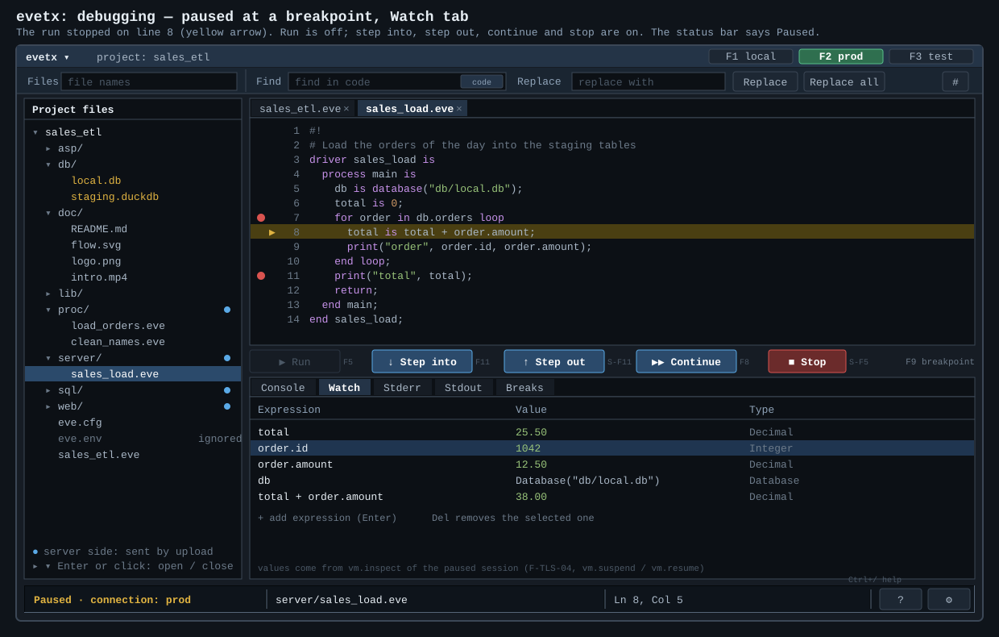
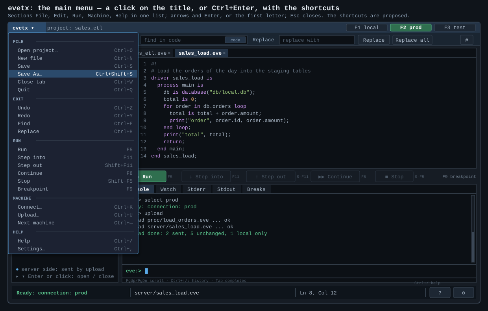
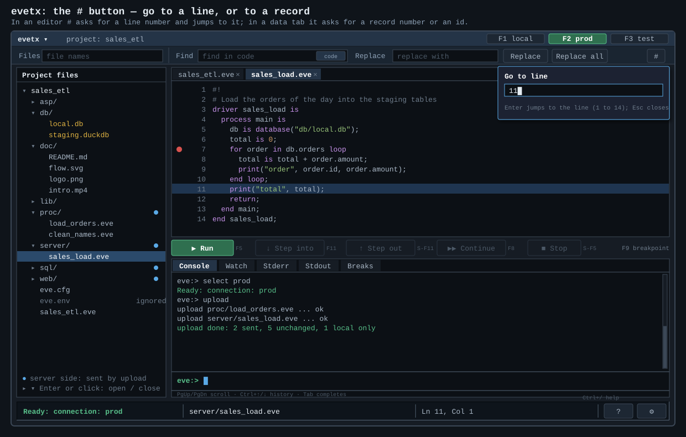
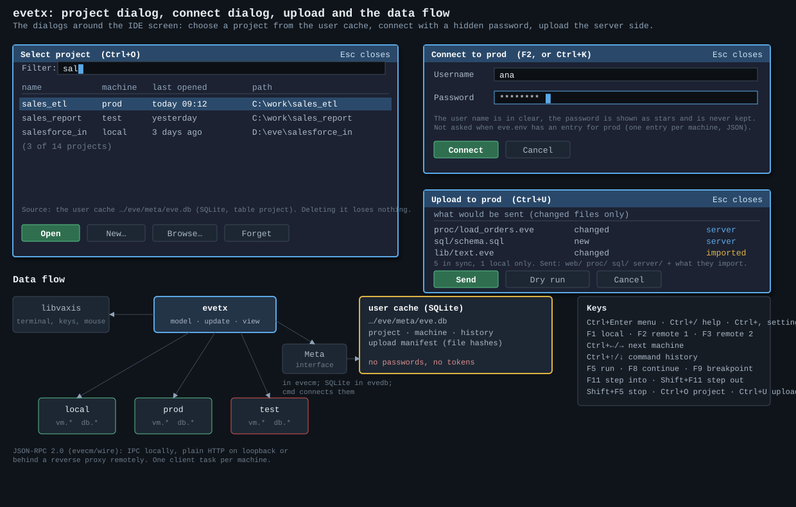

# evetx: the Eve text user interface

Status: **design for review**, eighth draft 2026-10-13 (D-174 to D-178). **Implementation started** (D-178): see §11. Nothing is built yet. Planned for **level 6** (version 0.0.6, phase B of [design-packages.md](../plan/design-packages.md), step B6). Recorded as Q-050, D-173 to D-178, Q-053 to Q-057 in [decision_level6.md](../plan/decision_level6.md); features F-TLS-24, F-TLS-27 and F-TLS-28 of [version_map.md](../plan/version_map.md). **Changed by the author on 2026-10-13 (D-173):** evetx is a **project IDE in the terminal**: a tree of the project files, an editor, run and debug buttons, a bottom panel, and database tabs. It is not a machine manager any more: the machines are chosen with F1 to F3. The first draft (a machines list in the sidebar, a Run view) is replaced; schedules and the management of runs stay in `eveux` (D-172).

## 1. What evetx is

`evetx` is a **full-screen terminal application** (TUI), written in Zig on the library **libvaxis**, in which a person works on **one Eve project** at a time:

- browses the files of the project in a **tree** (folders open and close);
- **edits** a file in the right panel, which opens at a click on the file;
- **runs** a program and **debugs** it (breakpoints, step into, step out, continue, stop, watch);
- reads **Console**, **Watch**, **Stderr**, **Stdout** and **Breaks** in the bottom panel;
- sees a **file card** (name, type, size) for a file that is not text: image, SVG, audio, video (no preview; `eveux` shows them rendered);
- opens a **database file** of the project, sees its tables, browses their data in tabs and edits the structure in a dialog;
- **connects** to a remote machine, **uploads** the server side of the project, and runs and debugs there; the machine is chosen with **F1** (local), **F2** (a remote machine), **F3** (another one).

It works over SSH and needs nothing but a terminal. It is the terminal sibling of the browser Workbench [eveux](../eveux/README.md): the same machine API, another screen.

| | `eveux` (level 7) | `evetx` (level 6) |
|---|---|---|
| Screen | browser (HTML, JavaScript, CSS) | terminal (libvaxis) |
| Written in | Eve (D-154) plus a small Zig door | Zig, with one dependency: libvaxis |
| Edit, run, debug | yes | yes |
| Databases | tree, SQL grid, import | tables, data tabs, structure dialog |
| **Schedules, run history, job browser** | **yes** (F-TLS-21, D-172) | **no** |

`evetx` does **not** run the user's code itself. Every run, step and query is a call of the machine API (`vm.*`, `db.*`, D-165) to the selected machine, the same call `eve -c … -rem <machine>` sends. What `evetx` can do is what the machine allows to the logged-in user. The code in the drawings is only illustrative.

## 2. The drawings

| Drawing | Shows |
|---|---|
| [design.svg](design/design.svg) | the main screen: file tree, editor tabs, run and debug buttons, bottom panel, status line |
| [design-debug.svg](design/design-debug.svg) | paused at a breakpoint: yellow arrow, Watch tab, Run off and the step buttons on |
| [design-breaks.svg](design/design-breaks.svg) | the Breaks tab: select a breakpoint, Remove it, or double-click to jump to it |
| [design-db.svg](design/design-db.svg) | a database file selected: its tables in a tab |
| [design-data.svg](design/design-data.svg) | the data of a table in a new tab |
| [design-structure.svg](design/design-structure.svg) | the structure dialog: a grid with headers and bordered cells, the type chosen from a list |
| [design-calendar.svg](design/design-calendar.svg) | the Default cell of a date or time field with its calendar |
| [design-menu.svg](design/design-menu.svg) | the main menu (a click on the title, or Ctrl+Enter) with the shortcuts, Save and Save As |
| [design-help.svg](design/design-help.svg) | the help dialog (Ctrl+/) |
| [design-goto.svg](design/design-goto.svg) | the `#` button: go to a line or a record |
| [design-filecard.svg](design/design-filecard.svg) | the file card of a binary file (image, SVG, audio, video) |
| [design-dialogs.svg](design/design-dialogs.svg) | select project, connect, upload, the data flow and the keys |













All the drawings are in [design/](design/). They are written by `design/gen_svg.py`; change a drawing there and run `python evetx/design/gen_svg.py` from the repository root, or edit an SVG by hand.

## 3. The screen

```
┌ title ▾ (menu) · project ───────────────────────── F1 local  F2 prod  F3 test ┐
│ Files [______] │ Find [______][code] Replace [______] [Replace] [Replace all] [#] │
├───────────────┬────────────────────────────────────────────────────────────────┤
│ project files │ tabs: file · file · table list · table data                    │
│  (tree)       │ editor, or table list, or table data                           │
│               │ [Run] [Step into] [Step out] [Continue] [Stop]      buttons    │
│               │ bottom tabs: Console · Watch · Stderr · Stdout · Breaks        │
├───────────────┴────────────────────────────────────────────────────────────────┤
│ ▕ state ▕ file or table name ▕ Ln, Col · Record, Field ▕ [?] [⚙] ▏  (inset)   │
└────────────────────────────────────────────────────────────────────────────────┘
```

**Title and main menu.** The title `evetx ▾` at the top left is a button: a click opens the **main menu**, and **Ctrl+Enter** opens the same menu from the keyboard. It lists File (Open project, New file, **Save**, **Save As**, Close tab, Quit), Edit (Undo, Redo, Find, Replace), Run, Machine (Connect, Upload, Next machine) and Help (Help, Settings), each with its shortcut ([design-menu.svg](design/design-menu.svg); the shortcuts are proposed, Q-054 a).

**The two searches and the `#` button** (under the title bar): the bar is split in two, and **each search sits above the panel it searches** (D-175, D-176, [design.svg](design/design.svg)).

| Control | Above | Does | Behavior |
|---|---|---|---|
| **Files** (left) | the file tree | finds a **file name** | **the names that start with the letters typed** (not the text anywhere): the tree **goes to the first match while you type**, opening the folders that lead to it, and keeps the rest of the tree in place; the matches are amber, the header says `1 of 2`; ↓ and ↑ go to the next and previous match, Enter opens the file, Esc clears the field and restores the folders as they were |
| **Find** (right) | the right panel | searches **code, table names or data**, by the tab that is open (the scope follows the tab) | an editor: the text of the file; a table list: the tables (the list is filtered); a data tab: **every column of the table**, global; a small tag in the field says `code`, `tables` or `data` |
| **Replace**, **Replace all** (right) | the right panel | replace in the text of an editor | on only for an editor; off in a table list and a data tab |
| **#** (right end) | the right panel | **jumps**: to a **line number** in an editor, to a **record** (its number, or its id) in a data tab | a small prompt under the button (Enter jumps, Esc closes; [design-goto.svg](design/design-goto.svg), [design-data.svg](design/design-data.svg)) |

**The data search.** It is global: it looks in **every column**. A `*` inside the text stands for any text (`op*n` finds `open`); a search that is a **number** finds by number (an id, a quantity, an amount equal to it). In the drawing `op*n` leaves the 3 rows whose status is `open`, and the database does the filtering (Q-056 c).

**Files that are not text** (D-178). **There is no preview in evetx and no preview button.** A text file (Eve, SQL, JSON, Markdown, HTML, any text) opens in the editor **as source**. Any other file, **including images, SVG, audio and video**, opens a **file card** with its facts: name, type, path, size, modification time, and which side it is on (local or server). The card says that **the rendered file is shown by `eveux`** (`eve -ux`), which draws images, SVG, Markdown and HTML properly ([design-filecard.svg](design/design-filecard.svg)).

**Settings** are opened by the gear of the status bar and by the menu (Q-054 b); the top bar no longer has a gear. Which field has the keyboard is shown by its blue border (Q-055 b).

**Status bar** (bottom, drawn as a bordered inset box with divided cells): the state (`Ready: connection: prod`, `Paused · connection: prod`, `Running…`), the **name of the file or table** that is selected, and the **place**: `Ln 8, Col 12` in an editor, `Record 1043 of 1,204 · Field: amount` in a data tab, `Table 1 of 4: orders` in a table list, `Field 5 of 9: amount` in the structure dialog. At the right, a button **?** (the help dialog, **Ctrl+/**) and a **gear** (settings, Q-054 b).

**Console** (bottom tab): it has **the design of the console of evevm** (`manual/usage.md`, "The screen"): the upper part is the output with its own scrollback (PgUp, PgDn, a scroll bar), then a rule, the command line `eve:> `, and a rule. Ctrl+Up and Ctrl+Down walk the history; Tab completes. The `Ready` and `Running…` state is in the status bar of the application (Q-054 h).

**Sidebar: the files of the project.** A tree: a folder opens and closes (click, Enter or the arrows) and shows its sub-folders and files. A click on a file opens it for editing in the right panel, in a tab. The server-side folders (`proc/`, `server/`, `sql/`, `web/`, Q-052 a) carry a blue dot: they are what the upload sends. `eve.env` is shown dimmed as ignored. A database file (`.db`, `.duckdb`) opens a table list instead of an editor.

**Tabs of the right panel.** Three kinds, and only three:

| Tab | Content |
|---|---|
| a **file** | the editor; the name shows a mark when the file is changed and not saved |
| a **table list** | the tables of a database file; opened by selecting the file in the tree |
| a **table data** | the rows of one table, page by page |

**The structure of a table is never a tab.** It is edited in a dialog (§6).

**Buttons above the bottom panel:** **Run**, **Step into**, **Step out**, **Continue**, **Stop** (keys proposed: F5, F11, Shift+F11, F8, Shift+F5; F9 toggles a breakpoint). Which are on depends on the state: idle (only Run), paused (all but Run), running (only Stop). Step over is not in the author's list (Q-053 e).

**Bottom panel, five tabs.**

| Tab | Content |
|---|---|
| **Console** | the command line of the machine (`eve:>`), its answers, `select`, `upload`, `db …`; Ctrl+Up and Ctrl+Down walk the history |
| **Watch** | expressions with value and type, from the paused session; add and remove expressions |
| **Stderr** | what the run wrote to the error stream |
| **Stdout** | what the run wrote to the output stream |
| **Breaks** | every breakpoint of the project: on or off, file and line, the source line; select one to **Remove** it, or double-click (or Enter, or **Go to**) to open the file at that line |

**Breakpoints.** A click on the gutter (or F9) puts a red dot on a line and adds it to **Breaks**; the same again removes it. A paused line has a yellow arrow and background.

**Machines.** The top bar shows `F1 local`, `F2 prod`, `F3 test`; the selected one is green. The status line says `Ready: connection: local` or `Ready: connection: prod` (the same words as the REPL, D-171). **F1** is the local machine, **F2** a remote machine, **F3** another one; **Ctrl+Left** and **Ctrl+Right** go through all of them. Run and debug act on the selected machine; on a remote one **only a program that was uploaded can run** (D-171), and Tab completes only stored procedures and code on the server.

**Dialogs.**

- **Select project** (`p`): the projects the user has opened, from the user cache (§5); filter, Open, New, Browse, Forget.
- **Connect** (F2 the first time, or `c`): the user name in clear and the password as stars, never kept; not asked when the `eve.env` of the project has an entry for the machine (D-172).
- **Upload** (`u`): lists what would be sent (changed files only: the server side and the modules it imports), with Send, Dry run and Cancel.
- **Structure** (§6).

**Rules.** Keyboard first, the mouse where the terminal sends it; a destructive action asks first and names the machine; colors and box drawing degrade on a poor terminal.

## 4. Databases in tabs

1. **Select a database file** in the tree: a **table list** tab opens (table or view, columns, rows). Enter on a table opens its **data** in a new tab; `S` opens its **structure** dialog; `N` makes a new table.
2. **The data tab** is a grid read page by page (PgUp, PgDn, Home, End), with a filter (`/`) and a sort (`s`). It is for browsing; the structure is not shown in it.
3. A database file is opened by the machine that owns it: the local machine for a local file, the remote one for a file on the server. The calls are the `db.*` methods (D-165), with the methods that the table list, the paging and the structure need added to the API (Q-053 c).

## 5. The user cache and where things live

`evetx` is a module of the split (D-163): **`evetx` imports `evecm` only**, like `eveux`, and the package libvaxis. The build refuses other imports. libvaxis is already a Zig library: there is no binding, no C and no `@cImport`; it is a dependency of this module alone, so a build without `evetx` does not fetch it.

- It reaches a machine only through the JSON-RPC client of `evecm/wire`; one task per machine (`std.Io`), so a slow machine never freezes the screen.
- The list of projects and machines, the history of commands and the upload manifest are in the **user cache** `eve.db` (SQLite, `<user data folder>/eve/meta/eve.db`), reached through the `Meta` interface of `evecm`, implemented by `evedb`, wired by `cmd` (Q-052 b). It holds no password and no token.
- Started by **`eve -tx`** (D-172); `eve tx` stays a synonym, and `./run.sh evetx` is the shortcut. `eve -ux` starts the web UI. A direct command, not a serving part (D-164).
- The line editor of `evecm/term` stays for the REPL; `evetx` takes the terminal (raw mode, alternate screen) only while it runs.

```
evetx/
├── README.md
├── design/             the SVG drawings and gen_svg.py
└── src/
    ├── root.zig        the module entry
    ├── model.zig       the state: tree, tabs, buffers, breakpoints, machines; pure data
    ├── update.zig      event + model → new model + requests; pure
    ├── view.zig        model → cells (libvaxis widgets)
    ├── editor.zig      the text buffer: lines, cursor, selection, undo; pure
    ├── client.zig      one task per machine: calls, timers, replies as events
    └── dialogs.zig     project, connect, upload, structure
```

- **Elm-style loop.** Key, mouse, resize and machine replies are events in one queue; `update` is a pure function; `view` only draws.
- **No automated tests** (D-178): the author tests the screen by hand. The code keeps the model and update free of the terminal, because that is also the clearest way to write it, not for tests.
- **Zig is taught here:** every function, test and type gets its `// Zig tip:` block (`CLAUDE.md`).

## 6. The structure dialog

A **grid** with a header row and **bordered cells** ([design-structure.svg](design/design-structure.svg)): one **row per field**, one **column per attribute**: number, Name, Type, Not null, Key, Default. It is generated from the columns of the table.

- Arrows move from cell to cell; Enter edits the cell; Space switches a box (Not null).
- **Type** is chosen from a list: the **button in the cell** opens a drop-down of the types (↑ ↓ and Enter choose). The list is the types of the engine of the file, SQLite or DuckDB (Q-054 e).
- **Default** of a date or time field has a **calendar button** ([design-calendar.svg](design/design-calendar.svg)): a month, a day, and a time for TIMESTAMP and TIME; **Today** and **Now** give the expressions of the engine, a chosen day gives a fixed value (Q-054 f).
- When there are more fields than rows, **Next page** and **Previous page** show the others; the header says `Fields 1–6 of 9 · page 1 of 2`.
- **Add field** and **Remove field** change the list; **Apply** sends the changes, **Cancel** drops them. A line says `1 change pending`, and **S** shows the SQL that Apply will run. SQLite changes some things only by rebuilding the table (a new type for a column), DuckDB allows more; the dialog says what Apply will do (Q-053 d).

## 7. What the machine must give (Q-053 b, c)

| Need | Existing | To add |
|---|---|---|
| run, stop, suspend, resume, inspect, eval | `vm.run`, `vm.stop`, `vm.suspend`, `vm.resume`, `vm.inspect`, `vm.eval` (D-165) | the output of a run as two streams (stdout, stderr) |
| breakpoints, step | F-TLS-04 (open): `halt` breakpoints | set and clear a breakpoint by file and line; step into, step out; the paused place; eval in the paused frame |
| list the programs on a machine | none | `vm.programs` (D-172 point 7) |
| tables, rows, structure | `db.query`, `db.execute`, `db.stat`, `db.proc.list` | list tables and views with counts; a page of rows; describe a table; change a table |

## 8. Work plan (level 6, version 0.0.6)

Each step ends with the usual checks: the ReleaseSafe build, `runtest.py all`, `bmark.py --check`, `zig build test`. Dependencies on B1 to B4: [design-packages.md](../plan/design-packages.md) §10, step B6.

| Step | Work | Done when |
|---|---|---|
| **T0 Spike** | libvaxis as a dependency; a tree, a text area, tabs, a dialog; keys, mouse and resize; Windows Terminal and Linux | builds with Zig 0.16 on both; the decision on Q-053 a is written |
| **T1 Skeleton** | module `evetx`, the option `-tx`, the shortcut in `run.sh`, the arrow checked by the build; the frame with top bar, sidebar, tabs, bottom panel, status | `eve -tx` opens and closes cleanly; the terminal is restored after a crash and Ctrl-C |
| **T2 Model and editor buffer** | events, model, update, the text buffer with undo; tests with no terminal | scripted key sequences give the expected model and text |
| **T3 Tree and editor** | the tree of the project, tabs, open a file at a click, edit, save and Save As, syntax colors; the title and the main menu, the find and replace bar, the status bar, the help dialog | a project is browsed, a file edited, found, replaced and saved; the menu and the help open by key and by click |
| **T3b File card** | text files open as source, any other file opens a file card (D-178); no preview | an image, an SVG and a video open a card |
| **T4 Run and the bottom panel** | Run on the local machine, the Console with the design of evevm, Stdout, Stderr | a program runs from the screen and its output shows in the right tab |
| **T5 Machines, project, upload** | F1 to F3, the status line, the connect dialog, the user cache and the select project dialog, upload, run on a remote machine (needs B3 and the `Meta` interface) | two local machines on two loopback ports; an upload; a run of an uploaded program; a program not uploaded is refused |
| **T6 Debugger** | breakpoints, Breaks tab, step into, step out, continue, stop, Watch, the paused line (needs the machine debugger, F-TLS-04, and B2) | a program is paused at a breakpoint, stepped, watched and resumed to its end |
| **T7 Databases** | table list, data tab, the structure grid with the type list and the calendar (needs the `db.*` additions) | a table of a local SQLite file is listed, browsed in a tab, and a column is renamed in the grid |
| **T8 Polish and documents** | filters, small windows, no-color mode, key help; `manual/usage.md`; the tutorial page; `version_map.md` | a session script passes; `mdlinks.py check manual` clean |

If level 6 is too full, **T6 and T7 are the first to move** to the next version; the author decides (Q-053 a).

## 9. Open points

Q-053 in `decision_level6.md`: the size of the scope, the debugger of the machine, the methods to add, the structure changes, step over, what the editor must do, where a run goes when the file is local. Q-050 to Q-052 stay open for the registry, the layout and the user cache.

## 10. Risks

| Risk | Answer |
|---|---|
| libvaxis does not build with Zig 0.16, or on Windows | the spike T0 first; a pinned commit or a patch; the module is the only user |
| **An IDE is a large scope for one level** | the steps are ordered so that each is usable alone; T6 and T7 can move; the editor stays plain (Q-053 f) |
| The debugger of the machine does not exist yet | T6 waits for F-TLS-04; the screen can be built with a fake machine first |
| Two UIs (`evetx`, `eveux`) with the same features | they share only the machine API and the rules of D-171; no code is shared (Eve and JavaScript on one side, Zig on the other), so their screens may differ |
| A breakpoint on a line of a file that differs from the copy on the server | the upload manifest (hashes) tells; a run on a remote machine warns when the local file is changed and not uploaded |
| Table structure changes that SQLite cannot do in place | the dialog says what Apply will do; a rebuild asks first |
| **Keys the terminal cannot tell:** Ctrl+Enter is often the same as Enter, Ctrl+/ the same as Ctrl+_, Ctrl+Shift+S the same as Ctrl+S | libvaxis uses the enhanced keyboard protocol where the terminal has it; T0 tests Windows Terminal, the Windows console and Linux; F10 (menu) and F12 (help) are the fallback (Q-054 a) |
| No tests | the author tests by hand (D-178); a mistake shows on the screen first |

## 11. Implementation (D-178)

Started 2026-10-13, as a **separate Zig program** in this folder until the split of design-packages.md (phase A) exists: `build.zig` and `build.zig.zon` here, built from `evetx/` with `zig build -p ..` into `bin/evetx.exe` (like `evedb`). Run it as `evetx [project-folder]` (the default is the current folder). When the root `build.zig` is made (step A7) the folder becomes the module `evetx`, the option `eve -tx` starts it, and the module imports `evecm` only. libvaxis is pinned in `build.zig.zon` to the commit `5b0c724` (2026-10-07), the last one for Zig 0.16 (its `main` branch has moved to Zig 0.17). **There are no automated tests** (D-178): the author tests the screen by hand.

**Source** (`src/`): `main.zig` (the event loop), `app.zig` (state, keys, mouse, run, console, searches, menu), `view.zig` (all the drawing; it records the clickable places), `text.zig` (the text buffer of the editor), `project.zig` (the tree of files), `theme.zig` (the colors of the drawings), `keywords.zig` (**generated** from `spec/lexical/keywords.json` by `gen_keywords.py`; run it again when the keywords change).

**Works now (steps T1 to T4 for the local machine):** the frame of the drawings; the project tree (open and close, a click or Enter opens a file, the server-side folders are marked); tabs; an editor with colors for Eve (comments, strings, numbers, keywords), cursor, selection-free editing, Save, Save As, New, line numbers, Find (Enter next), Replace, Replace all, `#` go to line (`42` or `42:7`, also Ctrl+G); a file card for images, SVG, audio, video, archives and other binary files; breakpoints (F9, the Breaks tab; they are not sent to a debugger yet); the two searches (Files by prefix with Ctrl+P, the tree goes to the match; Find for the code); the main menu (a click on the title, Ctrl+Enter or F10); the help dialog (Ctrl+/ or F12); the inset status bar with the file, the line and column, `?` and the gear; Run (F5, the button): runs `eve <file>` and shows the output in the Console, Stdout and Stderr tabs; the console runs `eve <what you type>` (`run x.eve`, `--check x.eve`, `clear`), with a history (Ctrl+Up, Ctrl+Down). `eve.exe` must be in the PATH (put `bin/` there).

**Not yet:** Undo and Redo; selecting text and the clipboard; the debugger (step, continue, stop, Watch: step T6, needs the machine debugger); the machines F2 and F3, connect, upload, the user cache and the project dialog (step T5, with the machine API of phase B); the database tabs and the structure grid (step T7); Settings (Q-054 b); a find that filters tables or data (T7); the replace and find of Shift+Enter (previous match). **Known limits:** Run waits until the program ends (the screen does not update meanwhile, a long program freezes it); tabs in a file are replaced by four spaces when it is opened (a message says so); a column is one character cell, so wide characters are drawn out of place; Ctrl+Enter, Ctrl+/ and Ctrl+Shift+S need a terminal with the enhanced keyboard protocol (F10 and F12 work everywhere, Q-054 a); a second click on a breakpoint row jumps (there is no double click).

**Layout and input rework (2026-10-14):** a classic menu bar of upper case names (FILE, EDIT, SEARCH, RUN, MACHINE, and HELP at the right side: Shortcuts, Manual, Tutorial, About, Options). F10 or Alt plus the first letter opens a menu; Left and Right change menu, Up and Down and Enter choose, a letter jumps to another menu, the mouse hovers and clicks. The hot letters are amber; they are underlined when Alt is pressed or a menu is open (on Windows the Alt key alone is a key event). The SEARCH menu holds Find Text (Ctrl+F), Find File (Ctrl+P), Replace (Ctrl+H, Tab between the fields), GoTo (Ctrl+G) and Query (Ctrl+L, not yet); they are small dialogs at the top right and replace the search bar. Every panel has a border (blue where the keys go): the files tree, the editor with its tabs, the bottom panel. The tree has a folder and a file picture and connection lines (`├─ └─ │`). A middle click on a tab closes it.

**Dialogs and the project cache (2026-10-14):** every dialog has a × button at the right of its title and buttons at the bottom (the one that Enter does is green). File > Open project lists the known projects (Open, Import folder…, Forget, Cancel; Enter, Del, I); File > Open Folder (Ctrl+Shift+O) is a folder browser with the path field, the sub folders and Open as project, which adds the folder to the cache and opens it. The cache is for now the text file `evetx-projects.txt` (one absolute path per line, last used first) in `<user data folder>/eve/meta/` (`LOCALAPPDATA` on Windows); it moves into `eve.db` with the `Meta` interface. Alt+Left and Alt+Right change the active panel (Alt+Tab belongs to the operating system); the Run buttons belong to the Tools Panel and go when it is hidden.

**Editor and status bar (2026-10-14):** a click puts the cursor at the pointer, a drag selects (Shift+click extends), Shift with the arrows, Home, End, PgUp and PgDn selects, Ctrl+A selects all, Ctrl+C and Ctrl+X copy (the text goes to the clipboard of the system with OSC 52 too), Ctrl+V pastes; a paste made by the terminal arrives between two markers (bracketed paste) and is inserted as one piece. The status bar has the state, a fixed panel `Ln 9999, Col 999` and, aligned to the right, quick information about the current window (file, kind, lines, line ends, modified) or the project. The active window title is drawn in inverted colors. `.db`, `.duckdb`, `.sqlite` files have a disk icon in the tree. The About dialog shows the version of the root `build.zig.zon`. The MACHINE menu lists only the machines that are connected.

**Word moves and run commands (2026-10-14):** Ctrl+Left and Ctrl+Right move by word, with Shift they select. Run (F5, the button, RUN > Run) and Check syntax (F6) do not start at once: the command (`run <file>`, `--check <file>`) is typed in the prompt of the Console, shown in the status bar with a countdown, and starts after three seconds; Enter starts it now, Esc cancels it, typing keeps the text and stops the countdown. Every command goes into the console history (Ctrl+Up). The debugger commands (step, continue, stop) wait for the machine debugger (T6).

**Wrap, thin scroll bars and breakpoints by click (2026-10-14):** Edit > Wrap cuts long lines at the right edge (the cursor keys still move by line). Without it the horizontal bar is one row of thin line (`─` track, `━` thumb) with `<` and `>` buttons that scroll ten columns; the vertical bar is a thin line too (`│`, `┃`). With wrap the horizontal bar goes and the vertical one gets `^` and `v` buttons that scroll half a page. A click on a line number or the space next to it sets a breakpoint, a click on the red circle removes it.

**Session and bar glyphs (2026-10-14):** evetx writes where the user is to `evetx-session.txt` in the cache folder (the project, panel sizes and visibility, wrap, the open files with the cursor and the first line shown, the open folders of the tree, the selected row, the breakpoints), when the program ends and when a file opens or closes. A start with no folder reopens the last project and puts everything back; a start with a folder restores the session only if it is the same project. The scroll bars use a light shade `░` for the track, a full block `█` for the thumb and the triangles `▲ ▼ ◄ ►` for the buttons; the glyphs are constants at the top of `scrollBars` in `view.zig`.
